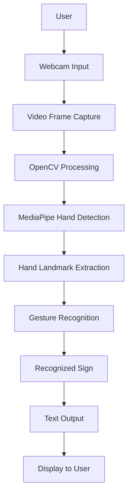

# AI Sign Language Translator

**Breaking Communication Barriers Through Artificial Intelligence and Computer Vision.**

AI Sign Language Translator is an intelligent application designed to bridge the communication gap between sign language users and people who may not understand sign language.

The project explores the use of Artificial Intelligence, Computer Vision, and hand gesture recognition to identify sign language gestures and convert them into understandable output.

By leveraging real-time hand tracking and gesture recognition, the application aims to make communication more accessible, interactive, and inclusive.

---

## 🌟 Key Features

| Feature | Description |
|---|---|
| 🤟 Hand Gesture Recognition | Detects and identifies hand gestures using computer vision techniques. |
| 📷 Real-Time Detection | Uses a camera to capture hand movements and process gestures. |
| ✋ Hand Tracking | Uses MediaPipe to detect and track hand landmarks. |
| 🧠 AI-Based Recognition | Applies machine learning or gesture classification logic to recognize supported signs. |
| 🔤 Sign-to-Text Conversion | Converts recognized gestures into corresponding text output. |
| ⚡ Live Processing | Processes camera input continuously to provide interactive recognition. |
| 🖥️ Interactive Interface | Provides a user-friendly experience for capturing and displaying recognized signs. |
| 🌍 Inclusive Communication | Explores technology-driven solutions to improve accessibility for people with hearing or speech-related communication barriers. |

---

## 🏗️ System Architecture

The application follows a computer vision-based architecture that processes camera input, detects hand landmarks, recognizes gestures, and generates corresponding text output.



### How It Works

1. **Camera Input:** The webcam captures the user's hand gestures in real time.
2. **Frame Processing:** OpenCV captures and processes video frames.
3. **Hand Detection:** MediaPipe identifies hands within the captured frames.
4. **Landmark Extraction:** Hand landmarks are detected to represent finger and hand positions.
5. **Gesture Recognition:** The extracted hand information is processed using the project's gesture recognition logic.
6. **Sign Identification:** The application identifies a supported sign or gesture.
7. **Text Generation:** The recognized gesture is converted into its corresponding text output.
8. **Display:** The recognized result is presented to the user.

---

## 🧰 Technology Stack

| Category | Technologies |
|---|---|
| Programming Language | Python |
| Computer Vision | OpenCV |
| Hand Tracking | MediaPipe |
| AI / Machine Learning | Gesture Recognition and Classification |
| Image Processing | OpenCV, NumPy |
| Development Environment | VS Code |
| Version Control | Git, GitHub |

---

## 🧠 AI and Computer Vision Implementation

The project combines computer vision and gesture recognition to interpret hand movements.

**1. Image Acquisition**

- Captures live video through a webcam.
- Extracts individual frames for processing.

**2. Hand Detection**

- Uses MediaPipe for hand detection and tracking.
- Identifies hand landmarks representing important hand positions.

**3. Gesture Processing**

- Processes the detected hand landmarks.
- Uses the implemented gesture recognition approach to distinguish supported signs.

**4. Sign Recognition**

- Maps recognized gestures to their corresponding sign or character.
- Handles supported gestures based on the project's recognition logic.

**5. Text Output**

- Displays the recognized sign as text.
- Provides an interactive way to understand the recognized gestures.

---

## 🚀 Running the Project Locally

### Prerequisites

Install the following:

- Python 3.11
- Webcam
- VS Code
- Git

### 1. Clone the Repository

```bash
git clone https://github.com/YOUR_USERNAME/AI-Sign-Language-Translator.git
cd AI-Sign-Language-Translator
```

### 2. Create a Virtual Environment

```bash
py -3.11 -m venv venv
```

Activate it on Windows:

```powershell
venv\Scripts\activate
```

### 3. Install Dependencies

If your project contains a `requirements.txt` file:

```bash
pip install -r requirements.txt
```

Otherwise, install the dependencies specified by your implementation.

Common libraries used in this type of project include:

```bash
pip install opencv-python mediapipe numpy
```

### 4. Run the Application

Run the main Python file used by your project.

For example:

```bash
python main.py
```

If your entry-point file has a different name, use that filename instead.

### 5. Test Gesture Recognition

1. Allow webcam access if prompted.
2. Position your hand clearly in front of the camera.
3. Perform one of the gestures supported by the application.
4. Observe the recognized sign or text output.

---

## 📁 Project Structure

```text
AI-Sign-Language-Translator/
│
├── main.py                 # Main application entry point
├── hand_tracking.py        # Hand detection and tracking (if separate)
├── gesture_recognition.py  # Gesture recognition logic (if separate)
│
├── models/                 # Trained model files, if applicable
├── dataset/                # Gesture dataset, if included
├── assets/                 # Images and other resources
│
├── requirements.txt        # Python dependencies
├── .gitignore
└── README.md
```

*The structure is illustrative. Update it to match the actual files and folders in your repository.*

---

## 🧪 Testing

Test the application using different hand positions, lighting conditions, and supported gestures.

Check the following:

- Webcam initialization.
- Hand detection accuracy.
- Landmark detection.
- Gesture recognition.
- Correct text output.
- Performance during continuous video processing.
- Handling of unclear or unrecognized gestures.

If automated tests are available, run:

```bash
python -m pytest -v
```

---

## ♿ Accessibility and Practical Applications

The project explores how AI-powered sign language recognition can support more inclusive communication.

Potential application areas include:

- Everyday communication.
- Educational environments.
- Accessibility-focused applications.
- Human-computer interaction.
- Communication assistance for sign language users.

**Important:** Sign languages have their own grammar, vocabulary, and regional variations. Recognizing a limited set of gestures is not equivalent to translating an entire sign language.

---

## 🔮 Future Enhancements

- Expand the number of recognizable signs and gestures.
- Improve recognition accuracy under different lighting conditions.
- Support continuous sign sequence recognition.
- Add sentence-level sign language interpretation.
- Integrate text-to-speech output.
- Explore speech-to-sign communication.
- Develop a multilingual translation interface.
- Improve recognition performance and real-time responsiveness.

---

## 👩‍💻 About the Project

AI Sign Language Translator is a Python-based Artificial Intelligence and Computer Vision project developed to explore the use of hand tracking and gesture recognition for accessible communication.

The project demonstrates how computer vision technologies can be applied to real-world accessibility challenges and human-computer interaction.

**Built with Python, OpenCV, MediaPipe, and AI-based gesture recognition.**

---

⭐ If you find this project interesting, consider giving the repository a star!
